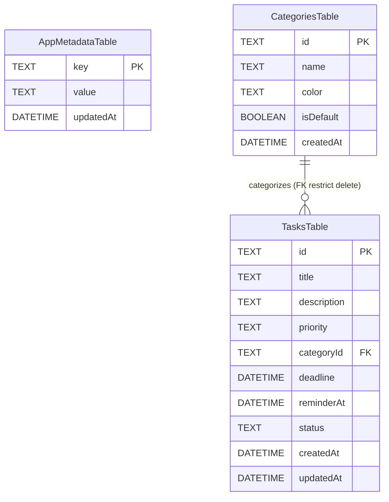

# Smart Professor Assistant — Database Schema

## 1. Overview
The database layer is managed by **Drift** backed by **SQLite** using `sqlite3_flutter_libs` with foreign keys enabled (`PRAGMA foreign_keys = ON`).

- Database file: `smart_professor_assistant.db`
- Current Schema Version: `2`

---

## 2. Tables & Entity ERD

---

## 3. Table Definitions

### 3.1 `categories_table`
Stores standard and custom academic categories.

| Column | Type | Constraints / Default | Description |
|---|---|---|---|
| `id` | TEXT | PRIMARY KEY | Unique category identifier (e.g., `cat_academic`, UUID) |
| `name` | TEXT | NOT NULL (1..80 chars) | Category title |
| `color` | TEXT | NOT NULL (Hex string) | Hex color code (e.g., `#1E3A5F`) |
| `is_default` | BOOLEAN | DEFAULT FALSE | Flag indicating if this is an undeletable core category |
| `created_at` | DATETIME | DEFAULT CURRENT_TIMESTAMP | Creation timestamp |

#### Default Seed Data:
1. `cat_academic`: Academic (`#1E3A5F`, default)
2. `cat_dept_admin`: Department Administration (`#4A5568`, default)
3. `cat_student_activities`: Student Activities (`#2B6CB0`, default)
4. `cat_research`: Research (`#C08A3E`, default)
5. `cat_meetings`: Meetings (`#805AD5`, default)
6. `cat_personal`: Personal (`#319795`, default)
7. `cat_other`: Other (`#718096`, default)

---

### 3.2 `tasks_table`
Stores professor tasks, deadlines, priorities, reminders, and execution states.

| Column | Type | Constraints / Default | Description |
|---|---|---|---|
| `id` | TEXT | PRIMARY KEY | UUID v4 |
| `title` | TEXT | NOT NULL (1..255 chars) | Task headline |
| `description` | TEXT | NULLABLE | Detailed notes or grading criteria |
| `priority` | TEXT | NOT NULL | `high`, `medium`, `low` |
| `category_id` | TEXT | NOT NULL, REFERENCES `categories_table(id)` | Foreign key to Category |
| `deadline` | DATETIME | NULLABLE | Target completion deadline |
| `reminder_at` | DATETIME | NULLABLE | Scheduled alert trigger time |
| `status` | TEXT | NOT NULL | `pending`, `in_progress`, `completed` |
| `created_at` | DATETIME | DEFAULT CURRENT_TIMESTAMP | Task creation timestamp |
| `updated_at` | DATETIME | DEFAULT CURRENT_TIMESTAMP | Last modified timestamp |

#### Indexes:
- `idx_tasks_deadline` on `deadline`
- `idx_tasks_status` on `status`
- `idx_tasks_category` on `category_id`
- `idx_tasks_priority` on `priority`

---

### 3.3 `app_metadata_table`
Stores global diagnostics and schema lifecycle data.

| Column | Type | Constraints | Description |
|---|---|---|---|
| `key` | TEXT | PRIMARY KEY | Metadata identifier |
| `value` | TEXT | NOT NULL | String value |
| `updated_at` | DATETIME | DEFAULT CURRENT_TIMESTAMP | Last updated timestamp |

---

## 4. Migration History
- **Version 1**: Initialized `app_metadata_table` and seeded `schema_initialized_at`.
- **Version 2**: Created `categories_table`, created `tasks_table` with foreign key and indexes, seeded 7 default academic categories.
